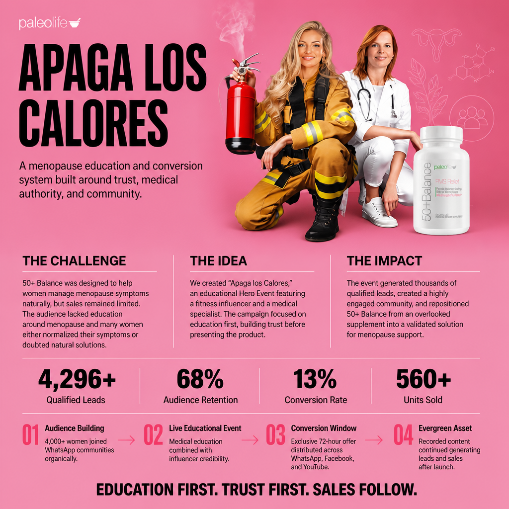

## The Challenge

50+ Balance was a supplement designed to help women manage menopause symptoms naturally. Although the product had a strong formulation and addressed a genuine market need, sales remained limited and it had yet to become a meaningful product line within the brand’s portfolio.

The main barrier was not the quality of the product, but the lack of education around the problem itself. Many women normalized symptoms such as hot flashes, insomnia, mood swings, and fatigue, while others were skeptical of available solutions or did not understand how a natural supplement could help.

The challenge was to reposition the product, build trust, and demonstrate value before asking for the sale.

---

## The Strategic Hypothesis

We identified that the problem was not demand—it was understanding.

Consumers first needed to understand what was happening in their bodies, what options were available to them, and why a natural solution could be part of the answer.

Instead of launching a campaign centered on discounts or product benefits, we decided to build an educational event capable of generating authority, community, and conversions at the same time.

---

## The Strategy

We developed “Apaga los Calores” (“Turn Off the Hot Flashes”), a Hero Event specifically designed for women navigating menopause.

The strategy was executed in four stages:

### 1. Audience Building

We launched a lead-generation campaign built around educational content focused on menopause and women’s wellness.

Interest exceeded expectations, filling four WhatsApp groups with more than 4,000 participants without any media spend, validating strong market demand for the topic.

### 2. Live Event

We hosted a webinar led by two complementary experts:

- Clara Divano (Cusifit), a fitness and wellness influencer.

- Dr. Maryory Gómez, a specialist in aesthetic gynecology and anti-aging medicine.

This combination allowed us to address both the everyday experiences of women and the medical credibility needed to overcome skepticism and objections.

The conversation focused on education, symptoms, quality of life, and natural approaches to managing menopause.

### 3. Conversion

Once trust had been established, we introduced an exclusive offer for attendees.

The offer was distributed through WhatsApp, YouTube, and Facebook, using a limited 72-hour conversion window to encourage decision-making.

### 4. Scalability

The event recording was transformed into an evergreen asset.

The content continued generating views, leads, and sales opportunities for weeks after the launch, while the community remained active and engaged for future brand initiatives.

---

## Results

The campaign generated more than 4,296 qualified leads across WhatsApp and Facebook.

Key performance indicators included:

- More than 4,096 WhatsApp subscribers.

- 68% audience retention, significantly outperforming the 55% benchmark.

- 32% click-through rate to the purchase offer.

- More than $25,800 in estimated revenue generated directly from the event.

---

## The Outcome

50+ Balance evolved from a product with limited commercial visibility into a solution supported by a highly engaged audience.

Beyond the sales generated during the launch, the brand gained three long-term strategic assets:

- A proprietary community of women interested in menopause and wellness.

- A repeatable education-to-conversion framework for future launches.

- Evergreen content capable of continuously generating demand and sales after the event.

The key lesson was that in categories where consumers face uncertainty, objections, or lack of knowledge, education can be far more effective than direct promotion.

By shifting the focus from selling to educating, the product established a deeper connection with the real needs of its audience and significantly accelerated the path to purchase.
