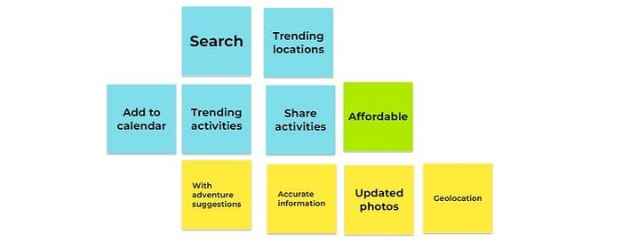
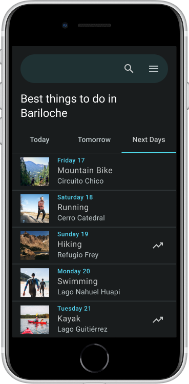

## The story of a geolocation-based app that helps you make better outdoor decisions

Photo by [Cristobal Baeza](https://unsplash.com/@temet?utm_source=medium&utm_medium=referral) on [Unsplash](https://unsplash.com/?utm_source=medium&utm_medium=referral)

Outdoor activities such as Kayaking, Windsurfing, Camping, or Hiking are increasingly popular worldwide. Although these activities can be enjoyed to the fullest when conditions are optimal, a lack of planning can lead to accidents or bad experiences. This is the story of Adventure Planner and how we came up with the plan to prevent them.

## **What Problems Do People Face on Short Adventure Trips and Why Should We Care**

Outdoor activities can be exhilarating and rewarding, but they also come with inherent risks that should never be taken lightly. A recent study conducted by the Spanish Civil Guard’s Mountain Service revealed that a **lack of adequate planning is the cause of more than 28% of incidents** in Aragon alone. And this trend is not limited to just one place: rescue teams from many tourist destinations around the world report incidents such as water accidents and even avalanche rescues every year.

While factors such as lack of physical preparation, inadequate equipment, and limited knowledge of the terrain contribute to these incidents, it is often poor planning that exacerbates the situation, endangering thousands of people.

**The consequences of poor planning can be devastating**, as seen in two separate incidents: one where a group of friends was rafting on a California river without checking the water conditions, resulting in a tragic drowning, and another where backcountry skiers in the Rocky Mountains did not consult avalanche forecasts, resulting in an avalanche that buried and killed two members of their group.

All of this highlights the crucial importance of proper planning and preparation before embarking on any outdoor activity. Thoroughly evaluating potential risks and hazards, having the necessary knowledge and skills, and having the appropriate equipment on hand are essential. Failing to do so not only endangers oneself but also others can have tragic consequences.

## **Improving the experience of thousands of people on their outdoor adventures could also save lives.**

To improve the experience and prevent accidents for people when doing outdoor activities, **we needed to understand and learn more about the context of the problem.** After conducting 21 surveys with men and women aged 20 to 65 and 3 interviews, we had what we needed to begin to understand a little more about the issue.

We learned that for non-experts, many of these outdoor activities are done as a couple or in small groups. We also discovered that many frequently use weather apps to make decisions about their daily activities and are very familiar with them. The most popular? Google Maps, Wikiloc and WindGurú.

Those who are not familiar with the city or area they are visiting, plan their activities to make the most of their days. As the stay in places is short (5–6 days), **tourists and adventurers try to do as many activities as possible** and not deviate from the plan. Ironically, unpredictable weather conditions are often the most significant factor in accidents and bad experiences.

**Key Findings:**

### The research allowed us to gather powerful insights to improve the experience of users when engaging in adventure activities:

1. **People use at least three different applications** to search for information about destinations, check the weather, and share their adventures.

1. Although useful and easy to use, people perceive **weather apps as creating generic forecasts**, and sometimes the information is not accurate.

1. People **don´t want to spend money** on planning their activities.

**Defining the Problem**

## Mark and Karen, a busy couple need to better organize their outdoor activities because they don’t have much time and want to enjoy their time to the fullest.

Our solution needed to help people like them, better plan their outdoor activities with **reliable, accessible, accurate, and easy-to-use information.**

Next, we made a list of the features and characteristics our app should include:

List of the features our app should include

We still needed to solve the main pain points and find a solution to improve the user experience. How could we create a solution that was accurate, easy, and accessible enough?

## **User study: Testing the prototypes**

Once the low-fidelity prototypes were completed, it was time to launch the Usability Test Plan to evaluate the design in key areas. The experiment involved 3 men and 3 women aged 25 to 60. We asked them to perform 3 tasks and give us feedback to help us better define the app’s design and usability.

**Usability Testing Tasks**

1. Check today’s activities in Bariloche and choose one suggested activity.

1. Check out the activities for tomorrow in Ushuaia.

1. Check out activities for the next few days in El Calafate.

We carefully reviewed the recordings of the test sessions and exposed the problems and complaints of each user. We used affinity maps to organize and group these weak points into categories.

Next, we traced possible solutions for each of the weak points and created user interface sketches to encapsulate the solutions.

Next days activities suggestions example in Adventure Planner App

**Conclusion**

Through research and testing, we were able to identify key problems such as **using multiple apps for planning, unreliable weather forecasts, and reluctance to spend money on planning**. Our app includes features such as geolocation, search engine, activity suggestions, and more to provide reliable and accessible information to help people plan and enjoy their outdoor adventures safely.

The user study helped us refine the design and make it even more user-friendly. With Adventure Planner, we hope to make outdoor activities safer and more enjoyable for everyone.

We answered many questions, and many more were opened. We will continue to work on new features and the scope of the app to make the world a safer and more entertaining place for millions of users.
