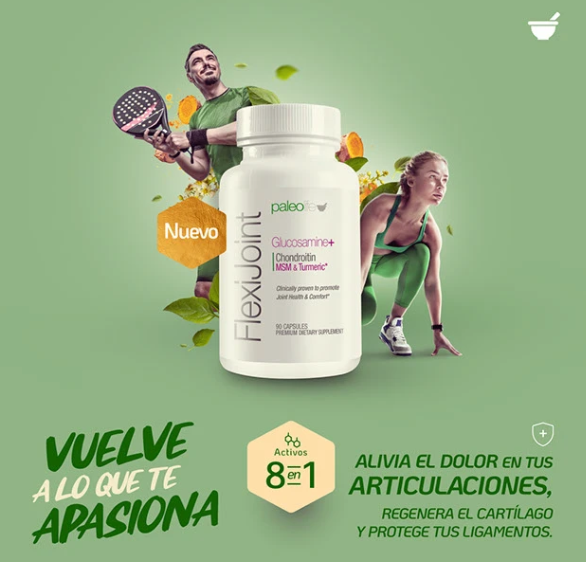

## Overview

FlexiJoint was developed to address a growing demand for comprehensive joint support among Paleolife customers. What began as a pattern uncovered through customer research evolved into a complete go-to-market strategy, including customer personas, positioning, brand story, creative direction, and a scalable launch campaign.

As Creative Strategist and Creative Lead, I was responsible for identifying the market opportunity, developing the research framework, defining the positioning strategy, creating the product narrative, leading the creative direction, and building a campaign platform designed for long-term scalability.

Today, FlexiJoint remains one of Paleolife's top-performing product lines and a strong example of how customer-led research can drive both product and marketing success.

## The Challenge

Paleolife already had successful products focused on healthy aging, including Collagen P18. While reviewing customer feedback across reviews, social media conversations, customer inquiries, and testimonials, I noticed a recurring theme.

Customers frequently mentioned joint discomfort, stiffness, reduced mobility, and concerns about maintaining an active lifestyle as they aged. Many were already using Collagen P18 for support but were actively searching for a more targeted solution.

The challenge was not simply launching another supplement into a crowded category. The challenge was understanding whether a meaningful market opportunity existed and how to position the product in a way that resonated beyond ingredients and clinical claims.

## The FREEDOM Framework

To structure the research process and transform customer feedback into actionable insights, I developed the FREEDOM Framework.

**F — Feedback Analysis:** Analyzed customer reviews, testimonials, support inquiries, and social conversations to identify recurring pain points and desired outcomes.

**R — Review Mining:** Examined existing product reviews, particularly from Collagen P18, to uncover patterns and identify adjacent customer needs.

**E — Emotional Mapping:** Identified the emotional motivations behind purchase decisions, focusing on what customers wanted to preserve or regain in their lives.

**E — Existing Customer Insights:** Leveraged historical customer data and previous product learnings to validate market demand and audience overlap.

**D — Demand Validation:** Cross-referenced insights across multiple sources to confirm a significant opportunity for a dedicated joint-health solution.

**O — Opportunity Identification:** Defined the strategic gap between what competitors were selling and what customers were actually seeking.

**M — Messaging Architecture:** Translated insights into personas, messaging pillars, positioning statements, and creative territories.

The framework revealed a critical insight:

**Customers weren't looking for better joints. They were looking for the freedom to continue doing what they love.**

This insight became the foundation for the entire launch.

## Persona Development

Using the research findings, I developed the primary customer personas that would guide messaging, creative production, and campaign development.

**Active Agers** wanted to maintain independence, mobility, and quality of life. Their goal wasn't to fight aging—it was to stay capable.

**Formerly Active Adults** were beginning to experience stiffness and discomfort that prevented them from enjoying activities they once loved. Their goal was reclaiming confidence in movement.

**Lifestyle Protectors** depended on mobility for work, hobbies, and everyday routines. Their priority was preserving the lifestyle they enjoyed today.

Rather than focusing on demographics alone, the personas were built around motivations, fears, and desired outcomes.

## Positioning Strategy

Most competitors in the category focused heavily on ingredients, formulations, and scientific claims. The research revealed an opportunity to build a more emotionally relevant positioning strategy.

Instead of selling joint health, we would sell what joint health made possible.

The positioning platform became:

### Get Back to Doing What You Love

The concept shifted the conversation away from symptoms and toward identity, freedom, and quality of life. It connected directly with the motivations uncovered during research while providing a clear emotional territory that competitors were largely ignoring.

## Building a Scalable Creative Platform

One of the strategic objectives was creating a campaign capable of supporting long-term creative production.

Many supplement launches rely on a single angle that quickly reaches creative fatigue. I wanted a platform capable of generating hundreds of variations while maintaining strategic consistency.

"Get Back to Doing What You Love" was intentionally designed for scalability.

The campaign could adapt to countless customer motivations:

- Get back to hiking.

- Get back to gardening.

- Get back to dancing.

- Get back to traveling.

- Get back to exercising.

- Get back to playing with your grandchildren.

Each variation spoke to a different audience segment while reinforcing the same core promise.

This allowed the campaign to scale across paid social, video ads, UGC, email marketing, landing pages, influencer partnerships, and organic content without requiring a new strategic direction.

Rather than creating a launch campaign, we created a long-term creative platform.

## Creative Direction & Brand Story

I also led the development of the product story and creative direction.

The category was saturated with clinical visuals, ingredient-focused messaging, and symptom-driven communication. Instead of following category conventions, I built the brand around movement, vitality, and possibility.

The central narrative was simple:

**Movement equals freedom.**

When mobility becomes limited, people don't just lose comfort. They lose access to experiences, routines, passions, and moments that define who they are.

FlexiJoint was positioned as the solution that helps customers maintain that connection to the life they want to continue living.

This narrative informed every aspect of the launch, from copywriting and visual identity to advertising concepts and content production.

## Launch & Impact

The launch campaign focused on emotional outcomes rather than technical specifications. Creative executions highlighted everyday moments customers valued most: staying active with family, exercising confidently, traveling freely, enjoying hobbies, and maintaining independence.

The product launched successfully across social channels and quickly established itself within Paleolife's portfolio. More importantly, it validated the original insight uncovered during the research process.

FlexiJoint remains one of the brand's top-performing products and continues to demonstrate the value of building products and campaigns around genuine customer motivations rather than product features alone.

## Key Takeaway

The success of FlexiJoint did not begin with a formula. It began with understanding what customers were truly afraid of losing.

By combining customer research, persona development, strategic positioning, creative direction, and scalable campaign architecture, we transformed a market opportunity into a lasting brand asset.

The project reinforced a principle that continues to guide my work today: **People don't buy supplements. They buy the ability to continue living the life they want.**
